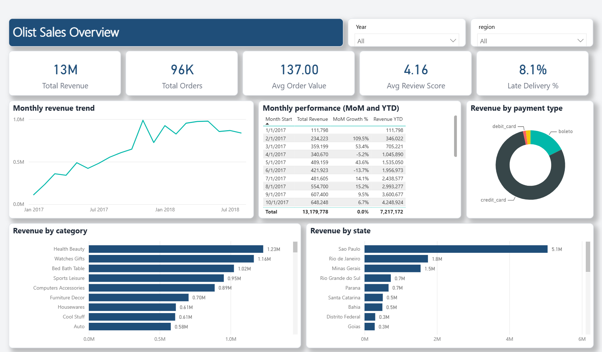
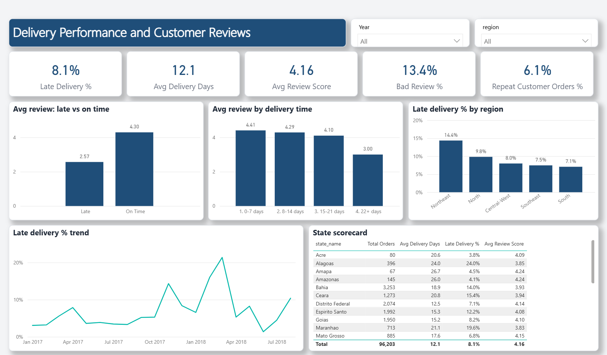

# Power BI Sales & Delivery Report (Olist)

   

A two-page Power BI report on 96K e-commerce orders, built on a star-schema model with
**Power Query** transformations and **14 DAX measures**.

Open `Olist_Sales_Dashboard.pbix` in Power BI Desktop to explore it.
The data preparation, SQL and Python analysis behind it is in
[olist-ecommerce-analytics](https://github.com/Vivek346282737/olist-ecommerce-analytics).

## Report pages

**Sales Overview**: KPIs, monthly revenue trend, month-over-month growth and year-to-date revenue, revenue by payment type, category and state.



**Delivery & Reviews**: late-delivery rate, review score by delivery time, regional comparison and a state scorecard.



## Data model

Star schema with one fact table and two dimensions:

| Table | Type | Rows | Relationship |
|---|---|---|---|
| `Orders` | Fact | 96,203 | - |
| `Date` | Dimension (date table) | 730 | `Orders[order_date]` -> `Date[Date]` |
| `State` | Dimension | 27 | `Orders[state]` -> `State[state_name]` |

## Power Query steps

Load CSV, promote headers, remove unused column, set data types, filter invalid rows, and add a
conditional column (`delivery_bucket`: 0-7, 8-14, 15-21, 22+ days).

## DAX measures

All 14 measures are listed in [DAX_MEASURES.md](DAX_MEASURES.md). Highlights:

```
Late Delivery %        = DIVIDE([Late Orders], [Total Orders])
Revenue Previous Month = CALCULATE([Total Revenue], DATEADD('Date'[Date], -1, MONTH))
MoM Growth %           = DIVIDE([Total Revenue] - [Revenue Previous Month], [Revenue Previous Month])
Revenue YTD            = TOTALYTD([Total Revenue], 'Date'[Date])
Revenue Share %        = DIVIDE([Total Revenue], CALCULATE([Total Revenue], ALLSELECTED(Orders)))
Category Rank          = RANKX(ALL(Orders[category]), [Total Revenue], , DESC, Dense)
```

## Key insights

- BRL 13.2M revenue from 96K orders; average order value BRL 137.
- 8.1% of orders are delivered late; late orders average a 2.57 review score versus 4.30 for on-time orders.
- Review score falls from 4.41 (delivered within 7 days) to 3.00 (22+ days).
- The Northeast region has the highest late-delivery rate (14.4%).

## Files

```
Olist_Sales_Dashboard.pbix     report file (open this)
OlistSales.pbip                Power BI project (text-based model and report definitions)
OlistSales.SemanticModel/      TMDL model: tables, relationships, measures, Power Query
OlistSales.Report/             report definition
build_pbip.py                  script that generates the data files and project definitions
data/                          fact and dimension CSV files
```

The Power Query source path in the project files points to a local folder; update it under
Transform data > Data source settings if you refresh the `.pbip` on another machine.

Data: Brazilian E-Commerce Public Dataset by Olist (CC BY-NC-SA 4.0).

## Author

**Vivek Prasad** - [LinkedIn](https://www.linkedin.com/in/prasadvivek123) | [GitHub](https://github.com/Vivek346282737) | [Tableau Public](https://public.tableau.com/app/profile/vivek.prasad5963)
